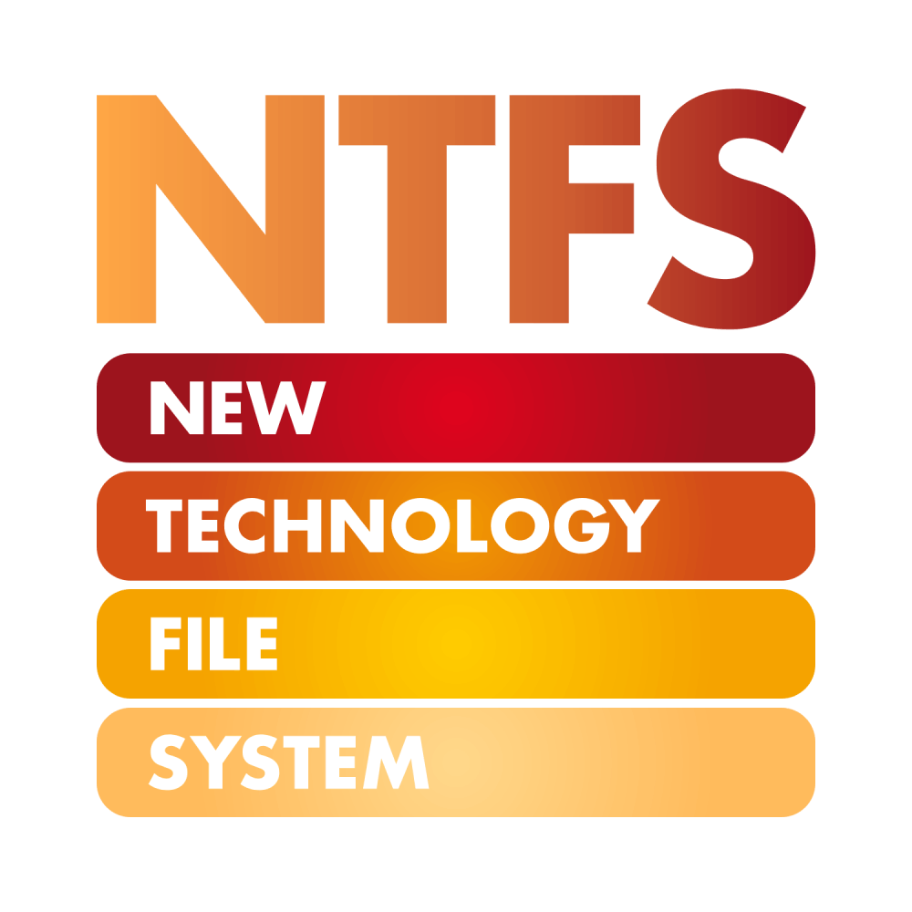

# HelloID-Conn-Prov-Target-NTFS-Folder

> [!IMPORTANT]
> This repository contains the connector and configuration code only. The implementer is responsible to acquire the connection details such as username, password, certificate, etc. You might even need to sign a contract or agreement with the supplier before implementing this connector. Please contact the client's application manager to coordinate the connector requirements.

<p align="center">
  
</p>

## Table of contents

- [HelloID-Conn-Prov-Target-NTFS-Folder](#helloid-conn-prov-target-ntfs-folder)
  - [Table of contents](#table-of-contents)
  - [Introduction](#introduction)
  - [Supported features](#supported-features)
  - [Getting started](#getting-started)
    - [HelloID Icon URL](#helloid-icon-url)
    - [Requirements](#requirements)
    - [Connection settings](#connection-settings)
    - [Correlation configuration](#correlation-configuration)
    - [Field mapping](#field-mapping)
    - [Account Reference](#account-reference)
  - [Remarks](#remarks)
    - [Post AD action scripts](#post-ad-action-scripts)
    - [Folder name based on sAMAccountName](#folder-name-based-on-samaccountname)
    - [Revoke uses stored account data](#revoke-uses-stored-account-data)
    - [Background jobs](#background-jobs)
  - [Development resources](#development-resources)
    - [PowerShell cmdlets](#powershell-cmdlets)
    - [Documentation](#documentation)
  - [Getting help](#getting-help)
  - [HelloID docs](#helloid-docs)

## Introduction

_HelloID-Conn-Prov-Target-NTFS-Folder_ is a _target_ connector that manages home folders and their NTFS permissions on an on-premises file server.

The connector does not create accounts itself. It correlates to an existing Microsoft Active Directory account (most likely created by the built-in Microsoft Active Directory target system) and uses that account to:

- Create the home folder on the configured share and grant the user _Modify_ permissions on it.
- Optionally set the `homeDirectory` and `homeDrive` attributes of the AD account.
- Archive the home folder when the permission is revoked.

If you only need to adjust the permissions on folders **created by the HelloID built-in AD connector (Home, TsHome, Profile or TsProfile)**, use one of the [Post AD action scripts](#post-ad-action-scripts) instead.

## Supported features

The following features are available:

| Feature                                   | Supported | Actions                 | Remarks                                                    |
| ----------------------------------------- | --------- | ----------------------- | ---------------------------------------------------------- |
| **Account Lifecycle**                     | ✅⚠️        | Create                  | Correlate only. No account is created, updated or deleted. |
| **Permissions**                           | ✅         | Retrieve, Grant, Revoke | Static (one permission: _Home Folder_)                     |
| **Resources**                             | ❌         | -                       |                                                            |
| **Entitlement Import: Accounts**          | ✅         | -                       |                                                            |
| **Entitlement Import: Permissions**       | ✅         | -                       |                                                            |
| **Governance Reconciliation Resolutions** | ✅         | Revoke                  | Only revoke permission                                     |

## Getting started

### HelloID Icon URL
URL of the icon used for the HelloID Provisioning target system.
```
https://raw.githubusercontent.com/Tools4everBV/HelloID-Conn-Prov-Target-NTFS-Folder/refs/heads/main/Icon.png
```

### Requirements

- **HelloID Provisioning agent (on-premises)**:<br>
  The connector runs on the on-premises agent, which must be able to reach the domain controllers and the file server.
- **ActiveDirectory PowerShell module**:<br>
  The `ActiveDirectory` module (RSAT) must be installed on the agent server.
- **Microsoft Active Directory target system**:<br>
  The AD accounts must already exist. Configure this connector as dependent on the system that creates the AD accounts.
- **Service account permissions**:<br>
  The HelloID agent service account requires:
  - Local admin on the file server.
  - Full Control on the share itself ([Share permissions](https://docs.microsoft.com/en-us/iis/web-hosting/configuring-servers-in-the-windows-web-platform/configuring-share-and-ntfs-permissions#:~:text=To%20configure%20permissions%20for%20the%20share), not NTFS permissions on the folder(s)).
  - Full Control on all folders on the share ([NTFS permissions](https://docs.microsoft.com/en-us/iis/web-hosting/configuring-servers-in-the-windows-web-platform/configuring-share-and-ntfs-permissions#:~:text=To%20configure%20permissions%20for%20the%20folder%20structuree), not Share permissions).
  - Write permissions on the `homeDirectory` and `homeDrive` attributes in AD, when _Set AD attributes_ is enabled.
  - Optionally, the following policies:
    - Local Policies > User Rights Assignment > Manage auditing and security log
    - Local Policies > User Rights Assignment > Back up files and directories
    - Local Policies > User Rights Assignment > Restore files and directories

### Connection settings

The following settings are required to configure the connector.

| Setting                 | Description                                                                                                                                     | Mandatory |
| ----------------------- | ----------------------------------------------------------------------------------------------------------------------------------------------- | --------- |
| Fixed domain controller | Optionally fill in a domain controller if a fixed domain controller is required. When empty, the PDC emulator of the forest root domain is used | No        |
| Set AD attributes       | When toggled, the `homeDirectory` and `homeDrive` attributes of the AD account are updated                                                      | Yes       |
| Drive letter            | Drive letter to be mapped to the home folder, for example `H:`                                                                                  | No        |
| Home folder Share       | Share where the home folders are created, for example `\\<servername>\<sharename>`                                                              | Yes       |
| Archive when revoked    | When toggled, the home folder is archived when the permission is revoked                                                                        | No        |
| Archive folder Share    | Share where the home folders are archived, for example `\\<servername>\<sharename>\<archive>`                                                   | Yes       |

### Correlation configuration

The correlation configuration is used to specify which properties will be used to match an existing account within _Microsoft Active Directory_ to a person in _HelloID_.

| Setting                   | Value                             |
| ------------------------- | --------------------------------- |
| Enable correlation        | `True`                            |
| Person correlation field  | `PersonContext.Person.ExternalId` |
| Account correlation field | `employeeId`                      |

> [!TIP]
> _For more information on correlation, please refer to our correlation [documentation](https://docs.helloid.com/en/provisioning/target-systems/powershell-v2-target-systems/correlation.html) pages_.

### Field mapping

The field mapping can be imported by using the _fieldMapping.json_ file.

| Field            | Description                                                                                   |
| ---------------- | --------------------------------------------------------------------------------------------- |
| `employeeId`     | Correlation field. Rename it to the correlation field used in the dependent system.           |
| `sAMAccountName` | Used as the folder name. Filled during correlation and stored in the account data.            |
| `SID`            | Used to grant the NTFS permissions. Filled during correlation and stored in the account data. |
| `Name`           | Used as display name during the account import.                                               |

### Account Reference

The account reference is populated with the `sAMAccountName` property of the correlated _Microsoft Active Directory_ account.

## Remarks

### Post AD action scripts
The folder `postAdAction` contains scripts to set permissions on an **already created** folder. Use them in the **Create** [Post Action](https://docs.helloid.com/hc/en-us/articles/360012421460-Configure-the-on-premises-Microsoft-Active-Directory-target-system#2.4.2:~:text=Post%20Action%20Configuration) of the [built-in Microsoft Active Directory target system](https://docs.helloid.com/hc/en-us/articles/360012421460-Configure-the-on-premises-Microsoft-Active-Directory-target-system).

| Script                                                    | Description                                                                                                                                       |
| --------------------------------------------------------- | ------------------------------------------------------------------------------------------------------------------------------------------------- |
| `postAdAction.create.SetDirectoryPermissions.Set-ACL.ps1` | Sets the permissions with [Set-ACL](https://docs.microsoft.com/en-us/powershell/module/microsoft.powershell.security/set-acl?view=powershell-7.2) |
| `postAdAction.create.SetDirectoryPermissions.icacls.ps1`  | Sets the permissions with [ICACLS](https://docs.microsoft.com/en-us/windows-server/administration/windows-commands/icacls)                        |

Both scripts can enable inheritance on the folder and grant the user permissions. These actions can be toggled with `$setPermissions` and `$enableInheritance`.

### Folder name based on sAMAccountName
- **Folder name**: The home folder path is `<Home folder Share>\<sAMAccountName>`. To use a different attribute for the folder name, change the field mapping and the path in the permission scripts.

### Revoke uses stored account data
- **AD account removed**: If the AD account no longer exists when the permission is revoked, the revoke script uses the stored account data (`$personContext.Person.Accounts.NTFS`) to find and archive the folder. The AD attributes are not updated in this case.
- **Target system name**: The default target system name `NTFS` is used. Change `NTFS` in `permissions/HomeFolder/revokePermission.ps1` if you use a different target system name.

### Background jobs
- **Timeout**: HelloID scripts have a 30 second timeout. Setting the ACL (grant) and moving the folder to the archive (revoke) therefore run in a background job. The result of the job is not returned, so HelloID always reports these actions as successful. For troubleshooting, use the commented direct command in the script instead of the job.

## Development resources

### PowerShell cmdlets

The following cmdlets are used by the connector.

| Cmdlet                | Description                                        |
| --------------------- | -------------------------------------------------- |
| `Get-ADUser`          | Correlate, import and retrieve the AD account      |
| `Set-ADUser`          | Set the `homeDirectory` and `homeDrive` attributes |
| `New-Item`            | Create the home folder                             |
| `Get-Acl` / `Set-Acl` | Grant the user permissions on the home folder      |
| `Move-Item`           | Move the home folder to the archive share          |

### Documentation

- [ActiveDirectory module](https://learn.microsoft.com/en-us/powershell/module/activedirectory/)
- [Set-Acl](https://learn.microsoft.com/en-us/powershell/module/microsoft.powershell.security/set-acl)
- [icacls](https://learn.microsoft.com/en-us/windows-server/administration/windows-commands/icacls)

## Getting help

> [!TIP]
> _For more information on how to configure a HelloID PowerShell connector, please refer to our [documentation](https://docs.helloid.com/en/provisioning/target-systems/powershell-v2-target-systems.html) pages_.

## HelloID docs

The official HelloID documentation can be found at: https://docs.helloid.com/
